# SRS Audit — ИИ-агент статической проверки требований

> **BCC-HUB x MNU FinTech Hackathon** · задание: [`docs/TASK.md`](docs/TASK.md) · проверяемый документ: [`docs/requirements.md`](docs/requirements.md)

Агент читает документ требований (`.md`, `.pdf`, `.docx`, `.txt`), нарезает его на атомарные требования, проверяет каждое требование и весь набор по **ISO/IEC/IEEE 29148:2018** (§5.2.5, §5.2.6, §5.2.7), **IEEE Std 830-1998** (§4.3) и **INCOSE GtWR v4**, добавляет банковский профиль Казахстана (UTC+5, тиын/ISO 4217, PCI DSS 4.0.1, идемпотентность, гонки) и пишет отчёт на русском языке.

**Главное свойство: 0 % выдуманных цитат.** Каждая цитата в отчёте найдена в исходном документе детерминированным верификатором, а номер строки вычислен кодом, а не моделью.

---

## Быстрый старт (3 шага)

### 1. Установка (Python 3.11+)

```bash
python -m venv .venv
# Windows:      .venv\Scripts\activate
# Linux/macOS:  source .venv/bin/activate
pip install -r requirements.txt
```

### 2. Ключ LLM

1. Откройте [aistudio.google.com/apikey](https://aistudio.google.com/apikey) → **Create API key**. Бесплатного тарифа достаточно.
2. Скопируйте пример конфига и вставьте ключ:

```bash
cp .env.example .env        # Windows: copy .env.example .env
```

```dotenv
GEMINI_API_KEY=ваш_ключ
GEMINI_MODEL=gemini-2.5-flash
```

Файл `.env` в Git не попадает (он в `.gitignore`). Вместо Gemini можно указать OpenAI, Anthropic или локальную Ollama — см. `.env.example`.
Проверить окружение: `python -m srs_audit doctor`.

### 3. Прогон одной командой

```bash
python -m srs_audit check docs/requirements.md reports/report.md
```

Отчёт ляжет в **`reports/report.md`** (папка создаётся автоматически). Дополнительно можно получить PDF и интерактивную HTML-подсветку:

```bash
python -m srs_audit check docs/requirements.md reports/report.md --pdf --html-highlight
```

Без ключа (или с флагом `--offline-lint`) агент работает только на детерминированных правилах: это 0 токенов и около 1 секунды, а в паспорте отчёта будет пометка об офлайн-режиме.

---

## Модель

| | |
| :--- | :--- |
| По умолчанию | `google:gemini-2.5-flash` (бесплатный тариф): на эталонном документе нарезает все 52 требования без единой галлюцинации цитаты; полный прогон ≈ 3 мин, повторный из кэша — секунды |
| Запасные (автоматически) | `gemini-flash-latest` → `gemini-flash-lite-latest` через `FallbackModel` при 503 «high demand», 429, исчерпании квоты или таймауте |
| Надёжность | таймаут 180 с на запрос, не более 3 попыток и 5 минут на агента, `thinking=low` (кроме прохода трассировки — `medium`); причины повторов видны в индикаторе прогресса |
| Сменить | `--model google:gemini-2.5-flash`, `--model openai:gpt-4o-mini`, `--model anthropic:claude-haiku-4-5`, `--model ollama:qwen2.5-coder:7b` или `SRS_MODEL` в `.env` |
| Лимиты Free Tier | не более 8 запросов в минуту (`aiolimiter`), ретраи с учётом `Retry-After` (`tenacity`) |
| Воспроизводимость | `temperature=0.1`; ответы кэшируются в `.cache.db` (SQLite, ключ — SHA-256 от модели, промпта и версии), поэтому повторный прогон бесплатен и даёт тот же результат (`--no-cache` — отключить кэш) |

Фактически ответившая модель записывается в паспорт прогона.

Во время прогона в терминале показывается живой индикатор `[···=#=#=#=#···] 01:23` с таймером и статусом каждого вызова агента (⟳ идёт, ✓ готово, ⚡ из кэша, ✗ ошибка и её причина). Если прервать прогон (Ctrl+C), завершённые вызовы останутся в кэше и повторный запуск продолжит с них.

## CLI

```
python -m srs_audit check <input_path> <output_path> [опции]
```

| Опция | Назначение |
| :--- | :--- |
| `--model, -m` | модель с префиксом провайдера (`google:`, `openai:`, `anthropic:`, `ollama:`) |
| `--profile` | `kz-banking` (по умолчанию) или `generic` — без финтех-правил РК |
| `--format, -f` | `md` (по умолчанию) или `json` |
| `--pdf` | дополнительно `<output>.pdf` (typst, встроенный кириллический шрифт DejaVu) |
| `--html-highlight` | дополнительно `<output>.html`: исходный текст с подсветкой дефектов и фильтром по серьёзности |
| `--offline-lint` | без LLM, только правила |
| `--no-cache`, `--cache-path` | управление кэшем LLM |
| `--quiet, -q` | минимум вывода |

**Коды возврата:** `0` — GO / CONDITIONAL GO, `1` — NO-GO, `2` — UNPROCESSABLE (битый или пустой файл). Их удобно использовать в CI как quality gate.

---

## Архитектура: 5-ступенчатый гибридный конвейер

```mermaid
flowchart LR
    IN[/"Документ<br/>.md .pdf .docx .txt"/] --> PF

    subgraph S1["1 · Preflight Gatekeeper"]
        PF["magic bytes · кодировка<br/>усечённый / зашифрованный PDF<br/>сканы · диаграммы"]
    end
    PF -- UNPROCESSABLE --> DIAG[["Диагностический отчёт<br/>exit 2, без LLM"]]
    PF -- OK / DEGRADED --> PARSE

    subgraph S2["2 · Парсинг с координатами"]
        PARSE["markdown-it AST · pymupdf + pdfplumber<br/>python-docx · Vision OCR для сканов"] --> SEG["Нарезка требований<br/>(код) + RequirementExtractorAgent"]
    end

    subgraph S3["3 · Детерминированный слой — 0 токенов"]
        DET["razdel + pymorphy3: слабые слова, лазейки,<br/>пассив, атомарность · IEEE 830: ID, ссылки, TBD<br/>API и финтех-правила РК"]
    end
    SEG --> DET

    subgraph S4["4 · LLM-агенты (pydantic-ai)"]
        QF["QualityFilterAgent<br/>батчи по 20 · фильтр ложных<br/>срабатываний (HLC)"]
        XC["CrossCheckFinTechAgent<br/>§5.2.6 + IEEE 830 §4.3<br/>матрица А↔B · 7 доменов<br/>+ трассировка критериев приёмки"]
        GR{{"Верификатор цитат<br/>rapidfuzz ≥ 86"}}
        QF --> GR
        XC --> GR
        GR -- "не найдена → ModelRetry (≤2)" --> QF
        GR -- "не найдена → ModelRetry (≤2)" --> XC
        GR -- "после ретраев" --> QR[("Карантин")]
    end
    DET --> QF
    DET --> XC

    subgraph S5["5 · Скоринг и отчёт"]
        SC["Индекс качества 0–100<br/>Go / No-Go гейт"] --> QS["QuestionSynthesizerAgent<br/>вопросы по ролям + EARS"]
        QS --> REP[["Отчёт: MD · JSON · PDF · HTML"]]
    end
    GR -- подтверждено --> SC
```



| Модуль | Роль |
| :--- | :--- |
| `preflight.py` | 0 байт, PNG под видом `.md`, бинарный мусор, CP1251/UTF-16, усечённый PDF (`%%EOF`), зашифрованный PDF/DOCX, `.doc`, ZIP вместо DOCX, PDF-сканы и страницы с диаграммами. Никогда не падает с traceback |
| `parsers/` | `md_parser` (AST `markdown-it-py`, `token.map` даёт точные строки; таблицы и code fences), `pdf_parser` (`pymupdf` `get_text("dict")` + `pdfplumber` только на страницах с таблицами), `docx_parser` (`iter_inner_content()` сохраняет порядок абзацев и таблиц) |
| `segmentation.py` | воспроизводимая нарезка: исходные ID (`Ф-1`), пункты списков, HTTP-статусы, строки критериев приёмки и таблиц параметров API |
| `analyzers/` | детерминированные правила (`deterministic.py`), словари GtWR (`lexicon.py`), NLP (`nlp.py`), выводы уровня набора и шаблонные вопросы для офлайн-режима |
| `grounding.py` | нормализация с картой индексов (ё→е, кавычки, тире, markdown), точный и нечёткий поиск, координаты строк и символов |
| `llm/` | фабрика моделей + `FallbackModel` + лимитер + `tenacity` + SQLite-кэш (`client.py`), 4 агента с `@output_validator` (`agents.py`), промпты (`prompts.py`) |
| `scoring.py` | индекс качества и Go/No-Go гейт |
| `reporting/` | Jinja2-шаблоны Markdown, PDF через typst, HTML-подсветка |

### Защита от галлюцинаций

1. **Evidence-first схема:** модель сначала приводит дословную цитату, потом рассуждение и вывод. Поля `verified_location`, `grounding_score`, номера строк в LLM-схему не входят, поэтому модель не может их подделать.
2. **Верификатор `grounding.py`:** цитата ищется точно, затем через `rapidfuzz.partial_ratio_alignment` (порог 86). Опечатки модели исправляются на дословный текст исходника, а перефразирование отклоняется.
3. **Контур самокоррекции:** ненайденные цитаты и несуществующие `req_id` возвращаются модели через `ModelRetry` с точным списком ошибок (до 2 попыток).
4. **Карантин:** то, что не подтвердилось после ретраев, в отчёт не попадает и выводится отдельной таблицей для эксперта.
5. **Citation Audit Badge** в паспорте прогона: *проверено → подтверждено → исправлено после ModelRetry → в карантине*.

### Индекс качества и гейт

`load = Σ w·n / N_требований`, `score = 100·e^(−load/1.5)`, веса: Blocker 10, Critical 5, Major 2, Minor 0.5.

| Вердикт | Условие |
| :--- | :--- |
| **NO-GO** | Blocker ≥ 1, или Critical ≥ 3, или score < 60 |
| **CONDITIONAL GO** | Critical 1–2, или Major ≥ 5, или score 60–79.9 |
| **GO** | Blocker = 0, Critical = 0, Major < 5, score ≥ 80 |

---

## Состав отчёта

Отчёт пишется на русском и соответствует разделу 6 задания:

1. **Паспорт прогона** — документ, дата и время с UTC-сдвигом, модель (и какая фактически ответила), версия агента (`git` commit/tag), здоровье файла, Citation Audit Badge, время и токены.
2. **Нарезка требований** — таблица «ID в отчёте | ID в документе | раздел / строка | тип | краткая формулировка / цитата».
3. **Проверка каждого требования** — вердикт по каждому требованию, затем дефекты с дословной цитатой, строкой, пунктом стандарта, обоснованием и правкой.
4. **Проверка всего набора** — 13 свойств (ISO 29148 §5.2.6 + IEEE 830 §4.3), матрица расхождений «БТ / UI / BPMN ↔ REST API», финтех-аудит по 7 доменам, пошаговая трассировка каждого критерия приёмки через правила документа, межтребовательные противоречия.
5. **Сводка** — число требований и нарушений по уровням, индекс качества, плотность дефектов, критичные дефекты (непроверяемые, противоречивые, неполные), статистика цитат.
6. **Итог и план действий** — GO / CONDITIONAL GO / NO-GO с основанием, что исправить в первую очередь, бэклог вопросов по ролям (PO / BA / SA / QA / InfoSec) с вариантами решения и правками «Было → Стало» в синтаксисе EARS, ручной чек-лист эксперта, карантин гипотез и отсеянные ложные срабатывания.

## Тесты

```bash
pytest -q
```

42 теста, без сети и ключей:

- 6 обязательных битых файлов (0 байт, PNG как `.md`, CP1251, усечённый PDF, зашифрованный PDF, PDF-скан) и ещё 8 краевых случаев;
- верификатор цитат, `razdel` + `pymorphy3`, детерминированные правила на эталонном документе;
- гейт и скоринг;
- **полный прогон конвейера с мок-моделью `FunctionModel`**: мок намеренно галлюцинирует, и тест проверяет, что ModelRetry исправляет цитату, упорная галлюцинация уходит в карантин, а не в отчёт, повторный прогон берётся из кэша, отказ провайдера деградирует до правил;
- CLI: коды возврата 0/1/2, форматы MD / JSON / PDF / HTML.

## Структура репозитория

```
src/srs_audit/      код агента (cli, pipeline, preflight, parsers/, analyzers/, llm/, reporting/)
tests/              pytest; битые файлы генерируются на лету
docs/requirements.md   проверяемый документ (выдан организаторами)
docs/TASK.md        исходное задание хакатона
assets/fonts/       DejaVu Sans для PDF (свободная лицензия Bitstream Vera / DejaVu)
reports/            отчёты прогонов
.env.example        пример конфига без ключей
```

## Ограничения

- Содержимое диаграмм (BPMN, sequence) в PDF анализируется только по тексту подписей; такие страницы перечислены в паспорте и в чек-листе эксперта. Для страниц-сканов включается Vision-распознавание через Gemini, но точность цитат на них ниже.
- Финтех-правила откалиброваны под банковские требования Казахстана; для других доменов используйте `--profile generic`.
- Отчёт — инструмент ревьюера, а не замена ему: ручной чек-лист в разделе 6 перечисляет то, что агент проверить не может (тарифы, согласования, реальные коды операций процессинга).
